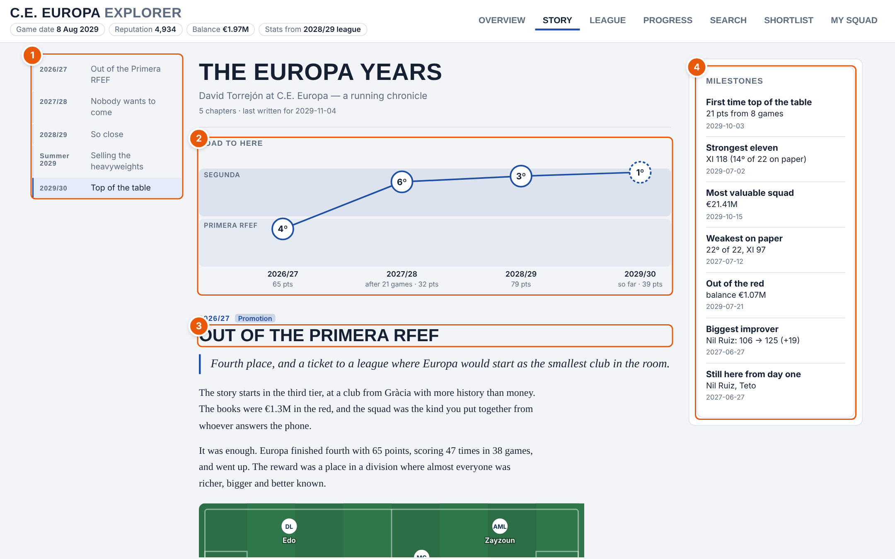
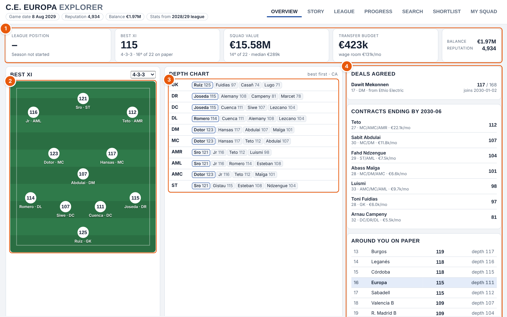
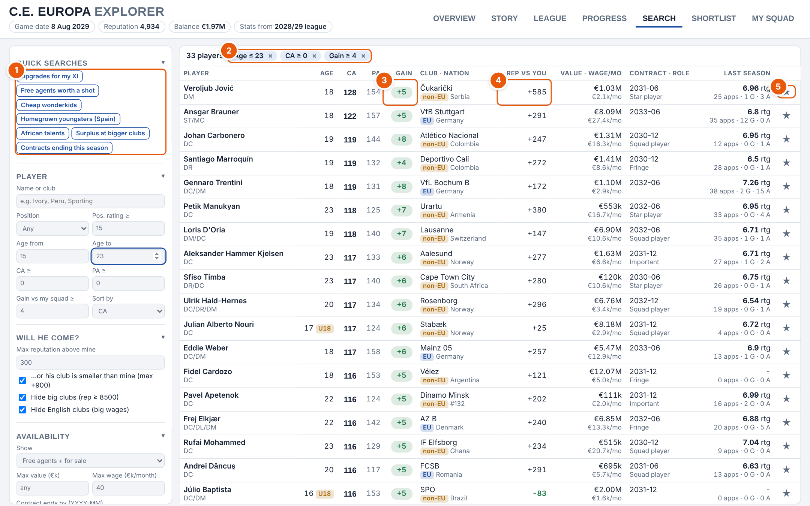
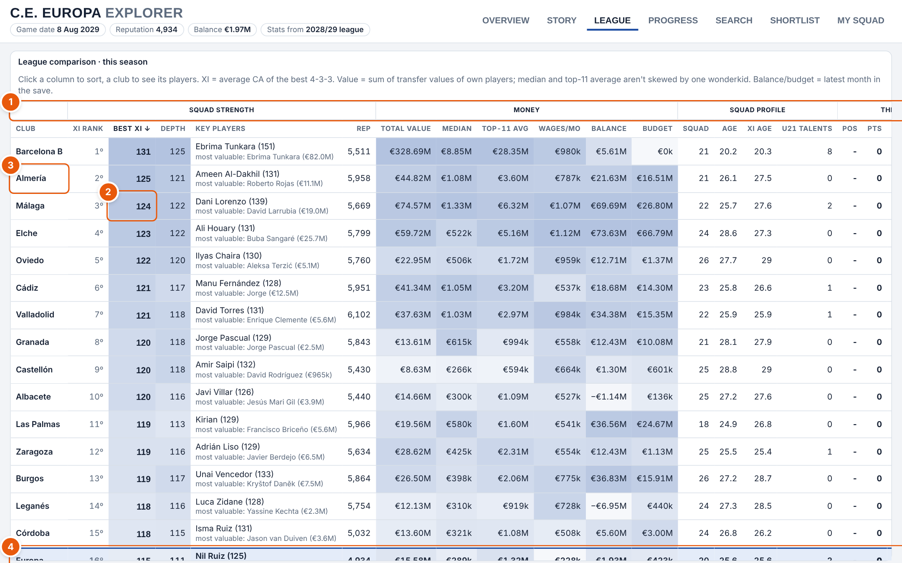
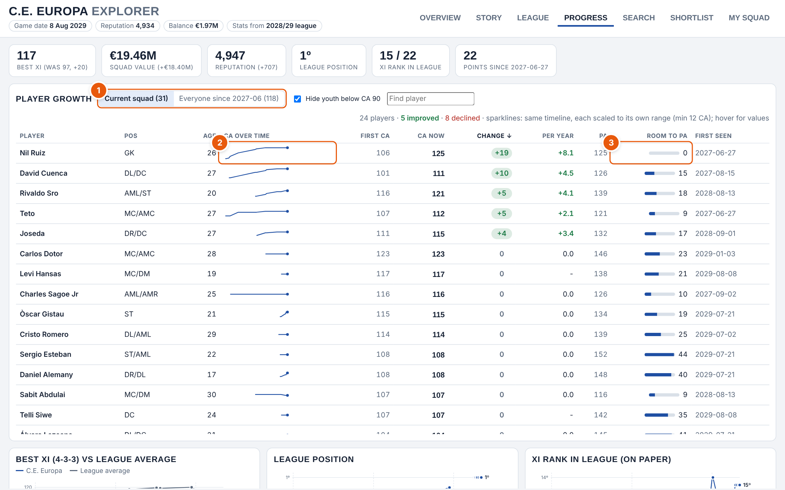
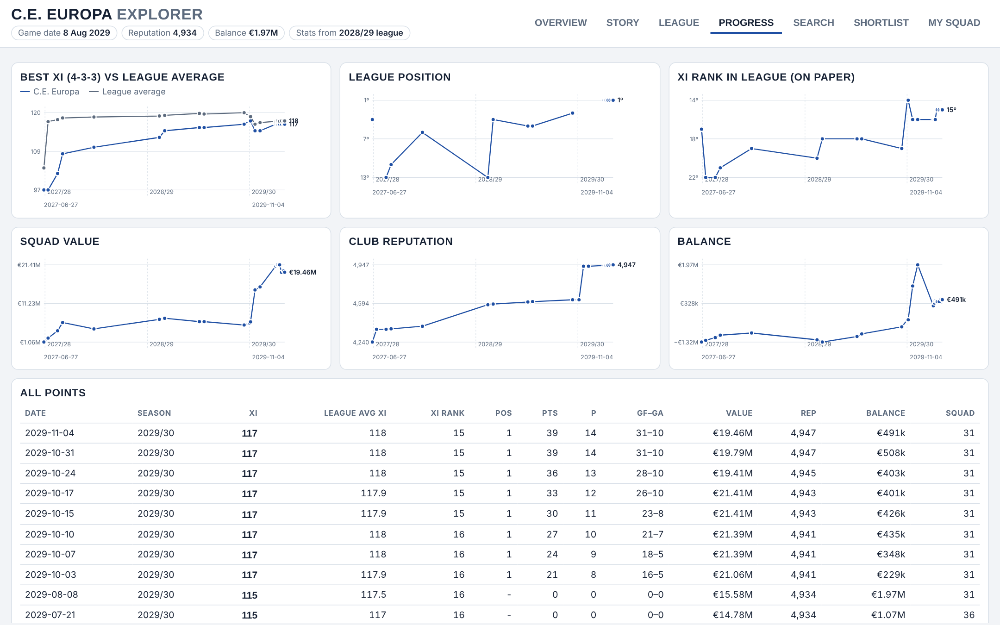
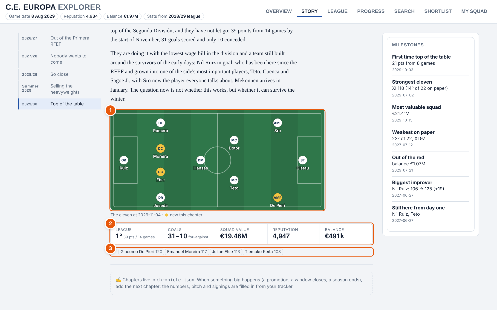
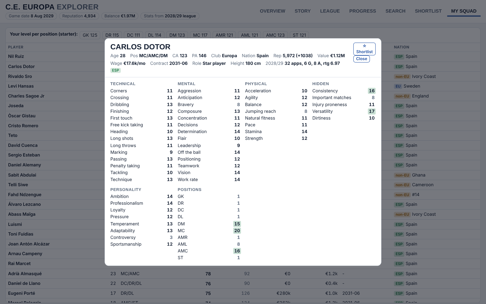

# Dugout: FM Explorer

**Turn a Football Manager 2027 save into a scouting database, league report and season tracker that open in your browser.**

> ### 🙏 Built entirely on [fmsave](https://github.com/rhiever/fmsave)
> This project would have been **impossible** without [fmsave](https://github.com/rhiever/fmsave) by [Randal S. Olson](https://github.com/rhiever). fmsave does all the hard work of reading FM27 save files; Dugout is just a small layer on top that turns that data into pages. Huge thanks for building it and sharing it openly. If you find this useful, go and star **fmsave** first.
>
> Dugout is a small extension and a fun side project made while playing a save. It's not a product, comes with no guarantees, and may break whenever the game or fmsave changes.

FM Explorer reads your `.fm` save, so you don't need to export views or take screenshots. It is built for managers at small clubs, where the question isn't "who is the best player?" but "who is better than my starter **and** will actually talk to me?".



<sub>Every screenshot comes from a real save: C.E. Europa, from the Primera RFEF to the top of the Segunda División.</sub>

## A quick tour

### Overview: your club at a glance


1. **Headline numbers**: league position, best XI (and where it ranks in your league), squad value, transfer budget and wage room.
2. **Best XI** on a pitch. Switch between 4-3-3, 4-2-3-1 and 4-4-2.
3. **Depth chart**: your top four per position, with the starter outlined and thin positions flagged.
4. **What's coming**: deals already agreed, contracts running out this season, and the clubs just above and below you on paper.

### Search: find players who are better *and* would actually come


1. **Quick searches** for common jobs: upgrades for your XI, free agents, cheap wonderkids, homegrown youngsters, African talents, surplus players at bigger clubs, contracts ending.
2. **Active filters** show as tags. Click × to remove one.
3. **Gain**: how much better he is than your current starter in that position.
4. **Rep vs you**: his reputation compared with your club's. Big gaps mean he probably won't talk to you.
5. **Star** a player to add him to your shortlist, then copy it or download it as CSV.

Clubs that won't sell (value €0), players with a future transfer already agreed, and players on loan are hidden by default.

### League: how you compare with every club in your division


1. **Grouped columns**: squad strength, money, squad profile and the table. Once the season starts the table comes first.
2. **Shading** ranks each column within the league, so outliers stand out without hiding everyone else.
3. **Click a club** to open its whole squad in Search.
4. **Your row** is outlined and stays easy to find.

*Median* and *top-11 average* value aren't skewed by one €80M wonderkid the way *total value* is.

### Progress: the season tracker


1. **Current squad or everyone** who has played for you since the first tracked point. Players who left are marked.
2. **A small CA chart per player** on a shared timeline. Hover over it for exact values.
3. **Room to grow**: how far each player is from his potential.



Every build adds a point, so you can follow your XI against the league average, league position, XI rank, squad value, reputation and balance across seasons.

### Story: the chronicle of your save


The Story tab turns your save into a club-history book. **You write the chapters** (title, pull quote, a few paragraphs), and Dugout fills in the rest from your tracker:

1. **The eleven of that chapter** on a pitch, with new arrivals in gold.
2. **The numbers** for that period: league position, goals, value, reputation and balance.
3. **Arrivals and departures**. Click any player to open his profile.

The top of the tab (first screenshot) has a chapter list (①), a *Road to here* timeline across divisions (②), the chapters (③) and automatic milestones (④): first time top of the table, strongest eleven, out of the red, biggest improver.

### Player profile


Click any name, anywhere, to open his full profile: attributes, hidden attributes, personality, positions, contract and last season's stats.

## Install (Windows)

1. Install **Python 3.10+** from [python.org](https://www.python.org/downloads/) and tick **"Add python.exe to PATH"**.
2. Download this repository (green **Code** button → **Download ZIP**) and unzip it anywhere.
3. Double-click **`Run FM Explorer.bat`**.

Every run installs or updates [fmsave](https://github.com/rhiever/fmsave), so fixes for new FM patches arrive automatically. Every run reads your newest save from `Documents\Sports Interactive\Football Manager 27\games`, which takes 1–2 minutes, and opens `fm_explorer.html`.
To use a specific save, drag the `.fm` file onto the `.bat`.

**Mac / Linux:** `pip install fmsave`, then `python3 fm_explorer.py "/path/to/save.fm"`.

### Watch mode (auto-refresh)

Double-click **`Watch FM Explorer.bat`** and leave it open while you play. Every time FM saves, including autosaves, the page rebuilds and the open tab at `http://localhost:8765/fm_explorer.html` reloads itself.

## Options

```
python fm_explorer.py [save.fm] [--min-ca 80] [--min-pa 120] [--young-age 23] [--all] [--no-open] [--watch] [--history-only]
```

- `--min-ca` / `--min-pa`: which players to export. The defaults (CA ≥ 80 or PA ≥ 120) keep the page fast.
- `--all`: export every player. This makes a big file and a slower page.
- `--history-only`: add an old save to the season tracker without building the page.

## Your files

Everything you generate stays next to the script and is ignored by git:

| File | What it is |
|---|---|
| `fm_explorer.html` | The generated page. It is self-contained, so you can send it to a friend |
| `history.json` | The season tracker. Every build adds a point. **Don't delete it** |
| `chronicle.json` | Your story chapters. See [`chronicle.example.json`](chronicle.example.json) |
| `settings.json` | Your default filters and extra nation names. See [`settings.example.json`](settings.example.json) |

### Writing the story

Each chapter has a date range, a title, a pull quote and paragraphs. FM Explorer adds the league position, goals, value, reputation, balance, the typical eleven and the arrivals and departures for that range from `history.json`. You can write chapters yourself, or give an AI assistant your `history.json` and ask it for the next chapter. In watch mode, a saved `chronicle.json` appears on the open page within seconds.

## Limitations

- **FM27 only**, and only as far as [fmsave](https://github.com/rhiever/fmsave) supports your game build. When an FM patch changes the save format you'll see an error like *"save layout differs from what fmsave expects"*. Restart the launcher to pull the latest fmsave, or run `pip install -U fmsave`. If it still fails, fmsave needs an update for that patch.
- Saves store **no nation names**. FM Explorer ships the common ones; the rest show as `#id` and can be named in `settings.json`.
- "Will he come?" is a heuristic based on reputation, not the game's own interest logic.
- Values and wages are what the save stores. The game may ask for different figures in negotiations.

## Credits

- **All save reading is done by [fmsave](https://github.com/rhiever/fmsave)** (MIT) by Randal S. Olson. Without it this project could not exist.
- Not affiliated with or endorsed by Sports Interactive or SEGA. Football Manager is a trademark of Sports Interactive. This tool only reads your own save files and ships no game data.

## License

[MIT](LICENSE)
